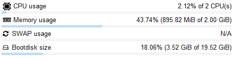
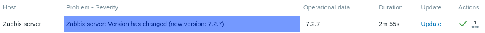

| [↩️ Back](./) |
| --- |

# ZABBIX PODMAN POD

Nowadays there are several reasons to use containers and some tools are available to manage them. [Podman](https://podman.io/) is such a tool, and besides Docker, it uses the [concept of Pods](https://kubernetes.io/docs/concepts/workloads/pods/), commonly used in Kubernetes.

Zabbix SIA provides Docker images for each Zabbix component to run as a portable and self-sufficient container. Also, [Docker Compose files](https://www.zabbix.com/documentation/current/en/manual/installation/containers) are available to define and run multi-container Zabbix components in Docker. Since Podman can use Docker images, it is easy to port them to a Pod context. One [can even use the compose file](https://github.com/containers/podman-compose) to launch Zabbix containers. However, out-of-the-box Podman is not ready to run the compose files.

There are multiple Zabbix components that are constantly communicating with each other. When deploying Zabbix components as containers, they must be tightly coupled and may need to share resources. With the Pod concept, these containers can form a single cohesive unit. So, to let Zabbix benefit from Podman's improvements, here's a simplified Pod proposal for Zabbix components in a Shell script format.

There are other differences between Podman and Docker, but this proposal is mainly intended for quick testing and development of Zabbix environments, while taking advantage of some of Podman's benefits.

<BR>

## Possible benefits

- ⭐ Fast deployment
- ⭐ Rootless container environment
- ⭐ Container isolation and shared resources within a Pod

<BR>

## Requirements

> **Many distributions offer packages for Podman, including Windows. Yet, this is a Shell script designed to run in a Linux environment.**

- 🛠️ [Install Podman](https://podman.io/docs/installation)
- 🛠️ [Basic setup](https://github.com/containers/podman/blob/main/docs/tutorials/podman_tutorial.md)
- 🛠️ [Rootless environment](https://github.com/containers/podman/blob/main/docs/tutorials/rootless_tutorial.md)
- 🛠️ [SystemD TimedateD](https://www.freedesktop.org/wiki/Software/systemd/timedated/) - _for timezone reading and Pod service management_

<BR>

---

### ➡️ [Script Download](./zabbixpod.sh)

---

<BR>

## Quick Setup

1. Copy the script to your environment
2. Make the script executable
    - `chmod +x zabbixpod.sh`
3. With Podman installed, start the script
    - `./zabbixpod.sh`
4. Access the Zabbix Frontend at port `8080`
    - `http://host.ip:8080`

<BR>

## The Script

⚠️ **The script has a number of variables to set up the Zabbix Pod environment. They can all be changed to suit your needs. However, it is recommended that you only change the first set of variables to avoid errors.**

```shell
# CHANGE VARIABLES HERE IF REQUIRED
ZBXMAJORVER="8"            # ZABBIX MAJOR VERSION
ZBXMINORVER="0"            # ZABBIX MINOR VERSION
DBROOTPASS="zabbix"        # DBMS ROOT PASSWORD
DBNAME="zabbix"            # ZABBIX DATABASE NAME
DBUSER="zabbix"            # ZABBIX DATABASE USER
DBPASS="zabbix"            # ZABBIX DATABASE PASSWORD
PORTWEB="8080"             # ZABBIX FRONTEND WEB PORT
PORTSNMP="1162"            # SNMP TRAP PORT
PORTMCP="8443"             # ZABBIX MCP SERVER PORT (ZABBIX 8.0+)
MCPALLOWEDIP="127.0.0.1,::1,10.0.0.0/8,172.16.0.0/12,192.168.0.0/16"    # MCP CLIENTS ALLOWED (ZABBIX 8.0+)
OSTAG="ol"                 # OS BASE IMAGE TAG
```

> _`PORTMCP` and `MCPALLOWEDIP` are only used when `ZBXMAJORVER` is `8` or higher; with older versions, they are ignored._

<BR>

**1.** The script first creates a Pod called `zabbix[VERSION]pod`.

**2.** Most of the attributes that make up the Pod are assigned to the `infra` container and cannot be changed once it is created. It has some volumes associated with it for the database, Zabbix server, and agent files, which allows for some data persistence. The data directory name is the same as the Pod.

```shell
[user@host ~]$ tree zabbix[version]pod/
zabbix[version]pod/
├── agent
├── mysql
│   ├── conf
│   └── data
└── server
    ├── alertscripts
    ├── externalscripts
    └── snmptraps
```

**3.** The Pod also binds some ports for Zabbix to receive connections.

- `8080/TCP` for Web access to Zabbix Frontend.
- `10051/TCP` for hosts to connect to Zabbix Server.
- `1162/UDP` for Zabbix to receive SNMP traps.
- `8443/TCP` for MCP clients to connect to Zabbix MCP Server (_Zabbix 8.0+ only_).

**4.** Following the Pod, a MySQL container is created. It is **not** bound to a routable network accessible from outside the Pod. Its credentials are set in the first variable set.

> ⚠️ When creating or upgrading the Zabbix database with a major version, MySQL requires the `log_bin_trust_function_creators` variable to be set to `1`; otherwise, the upgrade fails with an error such as _`You do not have the SUPER privilege and binary logging is enabled`_. To handle this, the script writes a temporary option file (`mysql/conf/zbx_db_upgrade.cnf`) before the Pod starts, so MySQL loads `log_bin_trust_function_creators=1` at startup. This file is removed, and the variable is set back to `0`, after the database is ready (_see step **6**_).

**5.** Next, Zabbix component containers are created, all bound to the `localhost` address of the Pod as a shared network namespace. Also, a web driver container is created for Zabbix browser items. The containers are:

- `Zabbix Server`
- `Zabbix Web Frontend`
- `Zabbix SNMPTraps`
- `Zabbix Web Service`
- `Zabbix Agent 2`
- `Selenium Grid Standalone Chrome`
- `Zabbix MCP Server` (_Zabbix 8.0+ only_)

**6.** The **first time** the Pod is launched, it may take ⚠️ **about 2 minutes to be able to access the Zabbix Frontend** while the database is being created. After starting the Pod, the script follows the Zabbix Server log (for up to `1800` seconds, set by `DBUPGRADETIMEOUT`) until the database creation or upgrade is finished:

- If the server starts successfully, the script runs `SET GLOBAL log_bin_trust_function_creators = 0;` in the MySQL container and removes the temporary option file.
- If the upgrade fails or the timeout is reached, the variable remains `1`, and the script prints the commands to revert it manually once the upgrade is finished.

**7.** SystemD is configured to control the Pod as a service, and the **`systemctl --user`** command can be used to start and stop the service.

> ⚠️ When the rootless user logs out of their session, any running containers are stopped. It is best to enable user lingering for your particular user so that the Pod can run automatically. If required, run the following command **as root**: `sudo loginctl enable-linger [pod user]`.

<BR>

## Test

In a small environment, very few resources are required to run this type of Pod, as shown in the image below. However, long-term stability has not been verified, and your mileage may vary depending on your requirements.



For testing purposes, let's create an environment to run the Zabbix Pod.

<BR>

### Environment

> _As of this writing, I'm testing with Zabbix 7.0 LTS and higher. With Zabbix 8.0 or higher, the output also includes the `zabbix[version]-mcp-server` container and the database creation/upgrade step._

🧪 **`Oracle Linux Server 9.8`**

🧪 **`Podman 5.8.2-rhel`**

<BR>

### Execution

Run the script (`./zabbixpod.sh`), and then it will create the containers inside the Pod. If the images are not found locally, Podman will download them, just like Docker.

```
[user@pods ~]$ ./zabbixpod80.sh 
$ ./zabbixpod.sh 

zabbix80pod POD CREATION
ab44a343f69a08996e0c90daa592de120c4ac5ccf4158da5da4f64de69c027f5

zabbix80-mysql CONTAINER CREATION
8f818f674c331fbe3750f1beecde4910398eb66ecf27f42ee84b11497bb7fe64

zabbix80-server CONTAINER CREATION
94253e80fa2aafddaaf22f384be176cad20365c6fb7996866456a229449065c2

zabbix80-web-nginx-mysql CONTAINER CREATION
53b642c3fded43c0f16effdd656b0f658f0ad58c14630c2d2e8dc295af2e82d7

zabbix80-snmptraps CONTAINER CREATION
bcfb1b04a23eff3db9599a3b26567a5a7618f89027e3c1c31d946ef748ad7f68

zabbix80-web-service CONTAINER CREATION
6f9141c5ea6eab22dab8443760303890bd75a0c707a5f06c5a1bb9a010a7441f

zabbix80-agent2 CONTAINER CREATION
d47eaea66a13b1e95933c74a1bd59a46a8d18da4cb5e9783b8a5a3224ca19506

zabbix80-selenium CONTAINER CREATION
3cc23a8019dc520ade026c8902ca22972b636400c886c974f297e5b469547ff0

zabbix80-mcp-server CONTAINER CREATION
726ce878ec8efe44369964b6006f998fa41b6226e3526802f7471cc8118b8293

SYSTEMD "zabbix80pod.service" SERVICE CREATION

mkdir: created directory '/home/user/.config/systemd'
mkdir: created directory '/home/user/.config/systemd/user'

/home/user/.config/systemd/user/container-zabbix80-agent2.service
/home/user/.config/systemd/user/container-zabbix80-selenium.service
/home/user/.config/systemd/user/container-zabbix80-mysql.service
/home/user/.config/systemd/user/container-zabbix80-mcp-server.service
/home/user/.config/systemd/user/zabbix80pod.service
/home/user/.config/systemd/user/container-zabbix80-web-service.service
/home/user/.config/systemd/user/container-zabbix80-web-nginx-mysql.service
/home/user/.config/systemd/user/container-zabbix80-server.service
/home/user/.config/systemd/user/container-zabbix80-snmptraps.service

Created symlink /home/user/.config/systemd/user/default.target.wants/zabbix80pod.service → /home/user/.config/systemd/user/zabbix80pod.service.
● zabbix80pod.service - Podman zabbix80pod.service
     Loaded: loaded (/home/user/.config/systemd/user/zabbix80pod.service; enabled; preset: disabled)
     Active: active (running) since Wed 2026-10-21 21:54:51 -03; 48ms ago
       Docs: man:podman-generate-systemd(1)
    Process: 14741 ExecStart=/usr/bin/podman start zabbix80pod-infra (code=exited, status=0/SUCCESS)
   Main PID: 14761 (conmon)
      Tasks: 2 (limit: 173630)
     Memory: 17.1M (peak: 31.9M)
        CPU: 47ms
     CGroup: /user.slice/user-1000.slice/user@1000.service/app.slice/zabbix80pod.service
             ├─14759 /usr/bin/pasta --config-net -t 8080-8080:8080-8080 -t 8443-8443:8443-8443 -t 10051-10051:10051-10051 -u 1162-1162:162-162 --dns-forward 169.254.1.1 -T none -U none --no-map-gw --quiet --net…
             └─14761 /usr/bin/conmon --api-version 1 -c 0fdc159cc1a1694e7d917f114ef6ec3973a6d5ff8ca49317d357280aed2886f1 -u 0fdc159cc1a1694e7d917f114ef6ec3973a6d5ff8ca49317d357280aed2886f1 -r /usr/bin/crun -b /…

WAITING FOR THE ZABBIX DATABASE CREATION/UPGRADE (UP TO 1800 SECONDS)

Zabbix database ready. log_bin_trust_function_creators set back to 0

Zabbix Pod started at http://192.168.8.197:8080
```

To confirm the Pod execution, its service status is shown. You may also list Pods with `podman pod list` and its containers with `podman ps -ap`.

```
[user@pods ~]$ podman pod list
POD ID        NAME         STATUS      CREATED        INFRA ID      # OF CONTAINERS
ab44a343f69a  zabbix80pod  Running     3 minutes ago  0fdc159cc1a1  9

[user@pods ~]$ podman ps -ap
CONTAINER ID  IMAGE                                             COMMAND               CREATED        STATUS        PORTS                                                                                                                               NAMES                     POD ID        PODNAME
0fdc159cc1a1                                                                          3 minutes ago  Up 3 minutes  0.0.0.0:8080->8080/tcp, 0.0.0.0:8443->8443/tcp, 0.0.0.0:10051->10051/tcp, 0.0.0.0:1162->162/udp                                     zabbix80pod-infra         ab44a343f69a  zabbix80pod
8f818f674c33  docker.io/library/mysql:lts                       --character-set-s...  3 minutes ago  Up 3 minutes  0.0.0.0:8080->8080/tcp, 0.0.0.0:8443->8443/tcp, 0.0.0.0:10051->10051/tcp, 0.0.0.0:1162->162/udp, 3306/tcp, 33060/tcp                zabbix80-mysql            ab44a343f69a  zabbix80pod
94253e80fa2a  docker.io/zabbix/zabbix-server-mysql:ol-trunk     /usr/sbin/zabbix_...  3 minutes ago  Up 3 minutes  0.0.0.0:8080->8080/tcp, 0.0.0.0:8443->8443/tcp, 0.0.0.0:10051->10051/tcp, 0.0.0.0:1162->162/udp                                     zabbix80-server           ab44a343f69a  zabbix80pod
53b642c3fded  docker.io/zabbix/zabbix-web-nginx-mysql:ol-trunk                        3 minutes ago  Up 3 minutes  0.0.0.0:8080->8080/tcp, 0.0.0.0:8443->8443/tcp, 0.0.0.0:10051->10051/tcp, 0.0.0.0:1162->162/udp                                     zabbix80-web-nginx-mysql  ab44a343f69a  zabbix80pod
bcfb1b04a23e  docker.io/zabbix/zabbix-snmptraps:ol-trunk        /usr/sbin/snmptra...  3 minutes ago  Up 3 minutes  0.0.0.0:8080->8080/tcp, 0.0.0.0:8443->8443/tcp, 0.0.0.0:10051->10051/tcp, 0.0.0.0:1162->162/udp, 1162/udp                           zabbix80-snmptraps        ab44a343f69a  zabbix80pod
6f9141c5ea6e  docker.io/zabbix/zabbix-web-service:ol-trunk      /usr/sbin/zabbix_...  3 minutes ago  Up 3 minutes  0.0.0.0:8080->8080/tcp, 0.0.0.0:8443->8443/tcp, 0.0.0.0:10051->10051/tcp, 0.0.0.0:1162->162/udp, 10053/tcp                          zabbix80-web-service      ab44a343f69a  zabbix80pod
d47eaea66a13  docker.io/zabbix/zabbix-agent2:ol-trunk           /usr/sbin/zabbix_...  3 minutes ago  Up 3 minutes  0.0.0.0:8080->8080/tcp, 0.0.0.0:8443->8443/tcp, 0.0.0.0:10051->10051/tcp, 0.0.0.0:1162->162/udp, 10050/tcp, 31999/tcp               zabbix80-agent2           ab44a343f69a  zabbix80pod
3cc23a8019dc  docker.io/selenium/standalone-chrome:latest       /opt/bin/entry_po...  3 minutes ago  Up 3 minutes  0.0.0.0:8080->8080/tcp, 0.0.0.0:8443->8443/tcp, 0.0.0.0:10051->10051/tcp, 0.0.0.0:1162->162/udp, 4442-4444/tcp, 5900/tcp, 9000/tcp  zabbix80-selenium         ab44a343f69a  zabbix80pod
726ce878ec8e  docker.io/zabbix/zabbix-mcp-server:ol-trunk       /usr/sbin/zabbix_...  3 minutes ago  Up 3 minutes  0.0.0.0:8080->8080/tcp, 0.0.0.0:8443->8443/tcp, 0.0.0.0:10051->10051/tcp, 0.0.0.0:1162->162/udp                                     zabbix80-mcp-server       ab44a343f69a  zabbix80pod
```

> _Note that the Pod was created under a non-privileged user (`$`) and all data is stored in the user's home directory._

<BR>

In this test, the Zabbix Frontend is accessible at `http://192.168.8.197:8080`. \
The default user and password are `Admin` and `zabbix` respectively.

\* You can also create multiple pods for different versions of Zabbix on the same host. Note, however, that each pod should use a different set of bound ports. These should be configured in the script variable set.

<BR>

## Zabbix MCP Server

From Zabbix 8.0 onwards, the script also creates a [Zabbix MCP Server](https://hub.docker.com/r/zabbix/zabbix-mcp-server) container. It gives AI agents access to Zabbix over the [Model Context Protocol](https://modelcontextprotocol.io/) (MCP), so they can browse hosts, triggers, problems and other monitoring data, and act on incidents (acknowledge, suppress or close problems, and manage maintenance periods).

The MCP Server reaches the Zabbix API through the Frontend container inside the Pod (`http://zabbix[version]-web-nginx-mysql:8080/api_jsonrpc.php`), and it keeps no credentials of its own.

**1.** Create an API token in the Zabbix Frontend (_Users_ ➡️ _API tokens_). The MCP client acts with the permissions of the token's user, and its actions are recorded in the Zabbix audit log under that user.

**2.** Configure the MCP client to use the **Streamable HTTP** transport with the following endpoint and header:

```
http://host.ip:8443/mcp
Authorization: Bearer <Zabbix API token>
```

**3.** Connections are only accepted from the addresses in `MCPALLOWEDIP`. By default, it allows localhost and the private network ranges, since rootless Podman networking may change the source address of the client. Narrow this list to suit your environment.

> **⚠️ Avoid unlimited access to AI agents. Prefer a token from a user with limited permissions.**

<BR>

## Upgrade

This script creates a local directory containing the pod volumes, which are persistent on the Podman host. This makes it possible to upgrade the Zabbix instance without losing data. **Basically, to upgrade Zabbix, stop and remove the pod and the container images, then restart the main script.** It should download the latest images available from the Docker Hub and recreate the pod. If it's only a minor upgrade, Zabbix should start with no major changes as it was previously. 

However, if it is a major upgrade, the local directory version number must be renamed to the newer major version. After running the script, Zabbix should start the automatic database upgrade. Depending on the data size, this process may take a while. It is also advised to follow the container logs (_`podman logs -f zabbix[version]-server`_) while the major upgrade is running to see if it was successful. The server log should display the message _`database upgrade fully completed`_.

The script handles the `log_bin_trust_function_creators` MySQL variable during the upgrade, as described in [The Script](#the-script) section. If the upgrade takes longer than `DBUPGRADETIMEOUT`, the script leaves the variable set to `1` and prints the instructions to revert it once the upgrade is finished.

🔽 Below are some suggestions on how to upgrade the instance in a few simple steps.

### Minor version upgrade

1. Stop the Zabbix pod.
    - `systemctl --user stop zabbix[version]pod`
2. Remove the pod and its containers.
    - `podman pod rm zabbix[version]pod`
3. Remove the local images.
    - `podman rmi $(podman images -a | awk '/zabbix-/ || /mysql/ || /standalone-chrome/ || /podman-pause/ {print $3}')`
    > ⚠️ **Note that this command will remove all images containing the strings `zabbix-`, `mysql` or `standalone-chrome`. Be careful not to remove other necessary images. If necessary, manually remove the container images.**
4. Rerun the Zabbix Pod script.
    - `./zabbixpod.sh`

### Major version upgrade

1. Stop the Zabbix pod.
    - `systemctl --user stop zabbix[version]pod`
2. Remove the pod and its containers.
    - `podman pod rm zabbix[version]pod`
3. Remove the local images.
    - `podman rmi $(podman images -a | awk '/zabbix-/ || /mysql/ || /standalone-chrome/ || /podman-pause/ {print $3}')`
    > ⚠️ **Note that this command will remove all images containing the strings `zabbix-`, `mysql` or `standalone-chrome`. Be careful not to remove other necessary images. If necessary, manually list and remove the container images.**
4. Change the Zabbix version variables inside the script. For example:
    > ```shell
    > # CHANGE VARIABLES HERE IF REQUIRED
    > ZBXMAJORVER="8"            # ZABBIX MAJOR VERSION
    > ZBXMINORVER="0"            # ZABBIX MINOR VERSION
    > ```
5. Rename the local directory with the new major version. For example:
    - _`mv zabbix74pod zabbix80pod`_
6. Rerun the Zabbix Pod script.
    - `./zabbixpod.sh`

> _When upgrading to Zabbix 8.0 or higher, the script also binds the `PORTMCP` port and creates the Zabbix MCP Server container. Since the Pod is recreated in step **2**, no further action is required._

<BR>

If everything went well, Zabbix should generate an event informing that it was updated and display the new version number.



<BR>

| [⬆️ Top](#zabbix-podman-pod) |
| --- |
